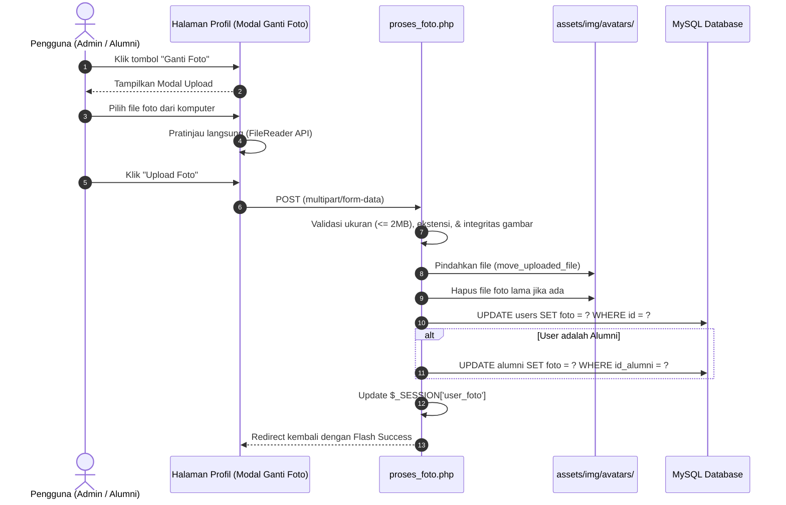

# Dokumen Spesifikasi: Fitur Ganti Foto Profil Semua Akun

Dokumen ini mendokumentasikan implementasi fitur pergantian foto profil (avatar) yang berlaku secara terpadu untuk semua jenis akun (Super Admin maupun Alumni).

---

## 1. Latar Belakang & Tujuan

Sebelumnya, avatar pengguna pada sistem bersifat statis menggunakan ikon Font Awesome (`fa-user-circle` atau `fa-user-shield`). 

**Tujuan Fitur:**
1. Memberikan kemampuan personalisasi identitas visual bagi seluruh pengguna (Admin dan Alumni).
2. Menyimpan dan mengelola foto profil dengan aman di server (`assets/img/avatars/`).
3. Mengintegrasikan tampilan foto profil di seluruh antarmuka: **Topbar Navbar**, **Sidebar Akun**, **Halaman Profil**, serta **Tabel Data Alumni**.
4. Menyediakan opsi ganti foto (dengan pratinjau langsung sebelum upload) serta opsi hapus foto (kembali ke avatar default).

---

## 2. Struktur Database

### 2.1 Kolom `foto` pada Tabel `users` & `alumni`

```sql
-- Kolom pada tabel akun pengguna
ALTER TABLE users ADD COLUMN foto VARCHAR(255) DEFAULT NULL AFTER role;

-- Kolom pada tabel data alumni (sinkron dengan akun alumni)
ALTER TABLE alumni ADD COLUMN foto VARCHAR(255) DEFAULT NULL AFTER no_hp;
```

- Ketika akun Admin mengubah foto: file tersimpan di `users.foto`.
- Ketika akun Alumni mengubah foto: file tersimpan di `users.foto` dan otomatis disinkronkan ke `alumni.foto`.
- Sesi aktif menyimpan nama file foto pada `$_SESSION['user_foto']`.

---

## 3. Aturan Validasi & Keamanan Upload

| Parameter | Aturan |
|---|---|
| **Ekstensi File** | `.jpg`, `.jpeg`, `.png`, `.webp`, `.gif` |
| **Maksimal Ukuran** | 2 MB (`2.097.152` bytes) |
| **Validasi Gambar** | Dicek menggunakan fungsi `getimagesize()` untuk memastikan file adalah gambar asli (mencegah file berbahaya/polyglot). |
| **Format Penamaan** | `avatar_{user_id}_{timestamp}_{random_hash}.{ext}` (unik dan acak, mencegah tabrakan nama dan *path traversal*). |
| **Pembersihan File Lama** | Ketika foto baru diupload atau foto dihapus, file fisik lama di server dihapus menggunakan `@unlink()`. |
| **Folder Simpan** | `assets/img/avatars/` dengan izin `0755`. |

---

## 4. Alur Kerja (Workflow)



---

## 5. Komponen Antarmuka (UI Components)

1. **Helper `render_avatar()` di [`includes/functions.php`](file:///c:/Users/ASUS/Downloads/pendataan-alumni-docs/pendataan-alumni/includes/functions.php):**
   - Menghasilkan tag `` melingkar (`rounded-circle`, `object-fit: cover`) jika file ada di server.
   - Menghasilkan ikon avatar fallback yang rapi jika pengguna belum mengunggah foto.
2. **Topbar Navbar ([`includes/header.php`](file:///c:/Users/ASUS/Downloads/pendataan-alumni-docs/pendataan-alumni/includes/header.php)):**
   - Menampilkan foto profil mini ukuran 32px di samping nama pengguna.
3. **Sidebar Box ([`includes/sidebar.php`](file:///c:/Users/ASUS/Downloads/pendataan-alumni-docs/pendataan-alumni/includes/sidebar.php)):**
   - Menampilkan foto profil 34px dengan teks nama pengguna dan badge role.
4. **Halaman Profil Admin ([`profil_admin.php`](file:///c:/Users/ASUS/Downloads/pendataan-alumni-docs/pendataan-alumni/profil_admin.php)) & Profil Alumni ([`profil.php`](file:///c:/Users/ASUS/Downloads/pendataan-alumni-docs/pendataan-alumni/profil.php)):**
   - Kartu identitas besar dengan avatar 110px.
   - Tombol **Ganti Foto** membuka modal interaktif dengan *live preview*.
   - Tombol **Hapus Foto** (ikon tempat sampah merah) dengan konfirmasi.
5. **Daftar Alumni ([`index.php`](file:///c:/Users/ASUS/Downloads/pendataan-alumni-docs/pendataan-alumni/index.php)):**
   - Menampilkan thumbnail foto profil 32px di sebelah nama lengkap alumni.
